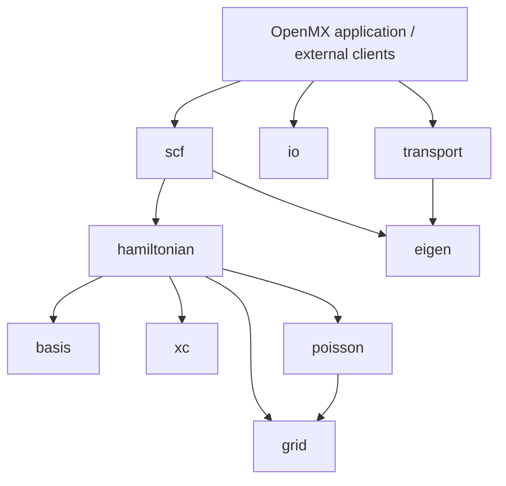

# OpenMX を組み立てる C++ 科学計算ライブラリ

## 最終的に何ができるようにするか

2026-10-27 のユーザー指定により、`openmx_crates_and_license_ja.pdf` の
2、4、5節にある構造を C++ で実現することを最終目標とします。
ライセンスの変更はこの移行の対象に含めません。

研究者が **OpenMX を改造せず、必要な物理機能だけを自分のプログラムから利用できる**こと、
開発者が **その部品の入力と出力だけで変更の正しさを短時間に確かめられる**ことが目的です。
OpenMX の実行ファイルは、それらのライブラリと並列実行・入出力を組み合わせる利用者になります。

例えば、PAO 基底だけを使う利用者は `OpenMX::basis` に依存し、基底データを読み、
動径・角度関数を評価し、2中心の重なり・運動エネルギー行列を取得できるようにします。
このとき SCF の初期化、OpenMX の大域変数の設定、MPI や CUDA の導入を要求しません。
一方、本体で同じ部品を使うときには、連続配置、通信分割、作業領域の再利用、
既存のCPU・GPU最適化を維持します。

大域変数の削減、RAII、多重ポインタの廃止、Kokkos、SIMD は、この目的を実現する手段です。
従来の到達目標も継続します。最終的には大域変数の使用をゼロにし、モジュール化・ユニットテスト・
C++とRAIIによる所有権を全体へ広げ、多重ポインタを廃止します。
既存のC ABIに残す互換ポインタ表も移行期間の措置であり、最終形ではありません。
変数を大きなコンテキストへ移すだけ、C++ に書き換えるだけ、CMake のターゲット名を増やすだけでは
ライブラリへの移行完了とはしません。

## C++ での部品境界

crate に相当する単位を、公開ヘッダー、実装、独立した `CMakeLists.txt`、単体試験、
インストール可能な CMake パッケージから成るライブラリとします。
C++20 の named modules を必須にはせず、C++ の型・可視性とターゲットの依存関係で境界を作ります。

以下は目標の責務と、そこへ移す既存実装です。`basis` の補間・PAO/VPS読み込み・原子密度演算・積分則生成・球Bessel評価・球面調和関数と実軌道変換・Gaunt角度積分以外は、まだ独立パッケージではありません。積分則には動径のGauss–Legendre則と球面のLebedev則を含みます。

| 目標ターゲット | 入力と返す結果 | 既存の移行元・今後の境界 |
| --- | --- | --- |
| `OpenMX::basis` | PAO/VPS データ、原子間変位 → 基底値・導関数、重なり・運動エネルギー・射影子積分 | 動径補間・PAO/VPS読み込み・原子密度補間とHartree積分・Gauss–Legendre/Lebedev則生成・球Bessel関数と2中心積分用Besselテーブル・球面調和関数と実軌道変換・Gaunt角度積分を `modules/basis/` へ独立済み。`core/` の Fourier変換、two-center、projector と実PAO評価の組み立てを順次統合する。 |
| `OpenMX::grid` | セル・格子・分割記述、基底サンプル・行列 → 密度、積分値、明示された通信データ | OLG、grid assembly、orbital/density/Hamiltonian grid の局所演算と、ハロー計画・転送実行を分離する。 |
| `OpenMX::xc` | 密度・勾配・スピン → 交換相関エネルギー密度・ポテンシャルと必要な導関数 | XC の局所物理関数を取り出し、汎関数・スピン規約を明示。libxc 等の選択はアダプター側。 |
| `OpenMX::poisson` | 密度・境界条件・セル → 静電ポテンシャル | FFT・分散配置・通信を明示したサービスから受け取り、解析解を持つ小問題で独立検証する。 |
| `OpenMX::hamiltonian` | 系、基底、ポテンシャル、配置 → H/S と力に必要な中間量 | Set_OLP_Kin、Set_Nonlocal、Set_ProExpn_VNA、Set_Hamiltonian、Force を物理演算ごとに接続する。 |
| `OpenMX::eigen` | 行列・分散配置・解法指定 → 固有値・ベクトル、残差・実行状態 | cluster/band、collinear/noncollinear、DC/DC-LNO/Krylov。ELPA/BLAS/ScaLAPACK/GEMMul8 はサービス境界に隔離する。 |
| `OpenMX::scf` | 系、SCF設定、解法・混合サービス → 収束履歴・電子状態・観測量 | mixing/chemical/energy と DFT の制御を組み合わせる。下位部品が SCF に依存しない。 |
| `OpenMX::transport` | リード・散乱領域の行列、積分設定 → Green関数・密度・透過率 | NEGF を SCF と結合可能な独立 API にする。下位に計算全体を初期化させない。 |
| `OpenMX::io` | OpenMX形式の入力・restart・結果ファイル ↔ 型付きの設定・系・結果 | プロセス終了、MPI通信、計算実行を解析器から除く。PAO/VPS 固有形式は basis 側で完結させる。 |

物理層の依存は上位から下位への有向非循環グラフにします。
共有するセル、原子、行列ブロック、単位・規約の型は必要になった段階で最小の共通層へ置き、
新しい巨大な `core` を共通依存として作り直さないようにします。

この図は物理的な責務の方向であり、すべての矢印を必須の静的リンクにする指定ではありません。
例えば基底上の局所演算は借用ビューで接続し、大きなデータを受け渡しのたびにコピーしません。

## 実行環境との境界

- CPU の物理部品は MPI、GPU SDK、HDF5 を初期化せずに利用できるようにします。
  必要な実行サービスは呼び出し元が供給し、基底評価から計算全体のコンテキストを参照しません。
- MPI communicator、分散行列・格子の所有範囲、通信計画を型と引数にします。
  communicator の暗黙取得や、エラー処理のための部品内部の `MPI_Abort` を除きます。
- CUDA/HIP/SYCL 等は、共有する物理データと演算契約を実装するバックエンドにします。
  CPU fallback は同じ入出力・誤差契約を満たすものとし、GPUの確保失敗でも検証可能にします。
- 外部ライブラリは必要な部品だけから依存します。実行時ロードが有効なサービスは
  アダプターで提供し、既に利用者が持つ runtime/communicator/handle を借用できるようにします。
  MPI等のABI・寿命の条件を整理してから導入し、単に `dlopen` へ置き換えて完了とはしません。
- 大きな配列と再利用する作業領域は明示的な所有者で管理し、内側のループには
  `span` / `mdspan` / `Kokkos::View` 等の軽いビューを渡します。
  バックエンドの選択や例外の捕捉は呼び出し境界で行い、要素ごとの仮想呼び出しを増やしません。
- NVIDIA の古いネイティブコンパイラとの互換 C ABI と、C++20 以上を使うホスト側ライブラリの
  コンパイラ境界を維持します。GeForce、A100/H100、Radeon/MI300 の配置・精度・滞留方針を
  一つの固定ポリシーにまとめません。

## 部品を「移行済み」と判定する条件

1. **単独で使える。** その部品と宣言した依存だけで構成・ビルド・インストールできる。
   外部の最小CMakeプロジェクトが `find_package` で利用でき、インストール先の移動後も動く。
2. **物理契約が明示される。** 単位、添字、軌道順序・位相、境界条件、所有／借用、エラー、
   並行呼び出しの条件を公開APIに書く。データを渡すだけで呼べ、隠れた可変状態を必要としない。
3. **局所的に数値を確かめられる。** 解析値と由来の分かる旧実装の中間データを用い、
   変更した物理演算の誤りをケース・チャネル・座標まで特定する。CPU の通常の単体試験は数秒を目指す。
   所有権だけを試すモデルや最終全エネルギーの一致で、物理演算の試験を代用しない。
4. **本体と外部利用者が同じ実装を使う。** 外部向けにもう一組の数値コードを作らない。
   移行中は C ABI の薄いアダプターを残し、上位へ依存する処理はアダプター側へ分離する。
5. **結果と性能を維持する。** 関係する CPU/GPU 経路の中間量、エネルギー、力、収束を比較する。
   定常ループの確保・コピーを増やさず、性能計測は同じ入力・MPI/OMP・デバイス条件で行う。
   sidia の GeForce+MPS 約105秒という目安とCPU性能を維持し、未検証のデバイスは区別する。
6. **境界をCIで守る。** 単独ビルド、数値試験、C ABI、外部利用、所有権・サニタイザー試験を登録する。
   新しい上位依存を追加した結果、部品だけの試験が全系実行を要求する状態に戻さない。

大域状態監査は引き続き、所有権を実際に移した段階だけでベースラインを更新します。
他LLM担当の設定298個・固定構造表278個の一括移行は、個別の物理部品の切り出しとは分けて扱います。

## 移行順序と現在の到達点

最初は既に局所数値試験のある基底処理から始め、外部利用できる入口を増やします。
既存の所有権移行は取り消さず、移行済みのクラスから必要な責務を引き出します。

1. **basis の動径・波数補間を独立化（第95段階で完了）。** `modules/basis/`、C++/C API、
   コピー・借用表、CMakeパッケージ、外部利用試験。本体の補間・Fourier変換前のサンプリングも同じ実装を使う。
2. **ファイルから基底を使える入口。** 第96段階でPAO固有の読み込みと基底メタデータを独立化し、
   外部プログラムからファイルの軌道を評価できるようにした。第97段階でVPSの新旧形式・
   射影子評価も追加し、密度補正等の本体処理と読み込みを分離した。実球面調和関数の規約と導関数、
   Fourier-Bessel/2中心積分は引き続き統合する。PAOの小試験は解析的な s〜g 軌道を使い、
   PAO395・VPS258ファイルの全数値を旧読み込みとビット単位で照合した。
   第98段階で原子密度の値・動径導関数・球対称Hartree積分を追加し、明示した格子・積分則だけで
   評価できるようにした。本体の積分則は初期化側から渡し、一時結果をRAIIで管理する。
   原点と格子上端外の従来規則を公開APIに記載し、解析値・旧実装の中間量で検証する。
   第99段階では積分則そのものも `GaussLegendreRule` が所有・生成する。
   原子データ準備の間だけ細密積分を借用し、`FineGL_Abscissae` / `FineGL_Weight` の
   大域実体を削除した。外部利用者はPAOを読むところからHartree積分まで同じライブラリで完結できる。
   第100段階では中密度の積分則も同じ `GaussLegendreRule` を計算ごとに所有し、
   `GL_Abscissae` / `GL_Weight` を削除した。Fourier変換とCPU/CUDA/HIPのVNA組み立ては
   明示された不変ビューを借用する。計算コンテキストは接続側の所有者であり、独立したbasisの依存にはしない。
   第101段階では粗い積分則も独立した所有者へ移し、`CoarseGL_Abscissae` / `CoarseGL_Weight` を削除した。
   Energy・Stress・参照XC積分のCPU/CUDA/HIP経路へ明示して渡し、3段階の積分表すべてで大域配列を廃止した。
   第102段階では球Bessel関数と、2中心積分で使うBesselテーブル／キャッシュを独立化した。
   外部プログラムは波数と距離だけで値・導関数を求められ、連続配列を所有するworkspaceを再利用できる。
   本体の重なり・非局所処理は同じ所有者を使い、CUDA/HIPのFourier変換も同じ漸化式を使う。
   球面調和関数は第103段階、Lebedev球面積分則は第104段階で独立化した。
   完全な2中心行列の外部APIは引き続き移行する。
3. **xc / grid と行列・分散記述。** 局所演算を優先し、通信を実行しない試験と実際のMPI試験を分ける。
   ここで Hamiltonian/Force が借用するデータの契約を整理する。
4. **poisson / eigen と外部サービス。** 解法の入力・出力・失敗・fallback の契約を統一し、
   CPU・GeForce・データセンターGPUそれぞれの実装を差し替え可能にする。
5. **hamiltonian / scf / transport / io を構成する。** 本体をライブラリの利用者へ移し、
   外部C/Fortran/Python/Juliaから必要な機能だけを呼べる層を段階的に整える。

現在の `core/` は多くの数値実装と計算所有ストレージを含む移行用の集合です。
今回だけで上の全目標、PAO基底の完全な外部利用、全計算の再入可能性が完成したわけではありません。
以後の作業単位は「どの物理機能を独立して使え、検証できるようにしたか」で記録します。

第103段階では球面調和関数とLegendre関数を独立basisへ追加しました。
積分用の非スケールφ微分と、軌道用のsinθで割ったφ微分を別のC++結果型にし、
必要な数値と導関数を状態の初期化や出力ポインタなしで取得できます。
本体は同じ計算核をC互換の内部ヘッダーからインラインで使います。
g軌道の両極の導関数と積分用の打切り規約を別々に保持し、物理規約の暗黙変更を避けています。
この変更は全PAO評価・2中心行列の独立化を完了するものではなく、その角度評価部分です。

第104段階では、590・1202・2030点のLebedev球面積分則を `LebedevRule` として独立化しました。
外部利用者は初期化済みの連続配列を所有し、読み取り専用spanから球面上の積分を評価できます。
本体のEnergy・StressとCUDA/HIPへの転送準備も同じ係数を使い、旧来の `double **` 行表は不要になりました。
計算呼び出しの寿命に所有者を結び付け、同じ点数の再取得は定数時間、容量内の変更は無確保です。
重みの和は1という規約を公開し、球面積分では4πを掛けることをC++の外部利用例で示しています。

第105段階では、複素球面調和関数を実軌道へ変換する `RealHarmonicTransform` を独立化しました。
位相・p/d/f以降の軌道順序を公開契約にし、外部利用者も同じ係数で値と導関数を変換できます。
所有データは連続配置の不変配列で、変換は重なった入出力に対応し、ヒープ確保を必要としません。
本体の `Comp2Real` 大域実体を廃止し、計算ごとの同じ所有者から重なり積分、非局所/VNA、
軌道評価、Voronoi角運動量、Wannier射影へ借用します。大域実体の削減と外部から使える
物理部品の追加を同じ変更で進め、巨大な可変コンテキストへ配列を隠すだけにはしていません。

第106段階では、3つの球面調和関数の積の積分を `gaunt()` として独立化しました。
位相、共役、整数角運動量と旧階乗表の対応範囲を公開契約にし、`GauntTable` が不変の連続配列を所有します。
本体の重なり・非局所・VNA・Wannierも同じ計算核を使い、VNAのホスト係数表は呼び出しごとの
準備所有者に移しました。初回の並行取得を同期し、構築失敗後は再試行でき、VNA2/3の両向きで
同じ表を無確保で再利用できます。可変大域キャッシュは追加せず、GPUの実行ポリシーも維持します。

第107段階では、この係数表と動径表をCPU SIMDへ渡す境界から、ワーカーごとの行ポインタ表を除きました。
基底の動径順序、重みの行間隔、GauntのLL/M0の間隔を明示し、同じ連続データをコピーせず参照します。
SIMDの数値作業領域も既存のワーカー所有者に結び付け、CPUへ処理を戻した場合にもRAIIを適用します。
これは本体の組み立て層の移行です。独立basisへGPU SDKや本体コンテキストへの依存を追加しません。
